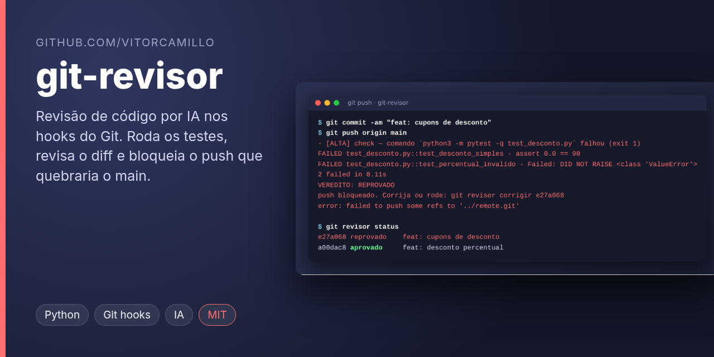
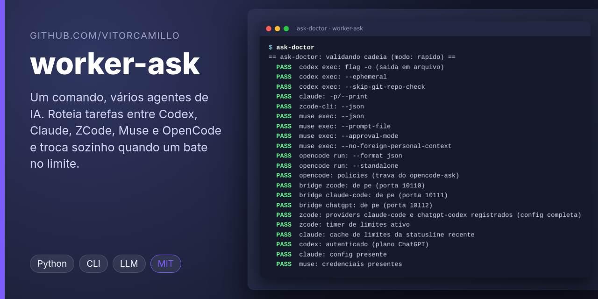
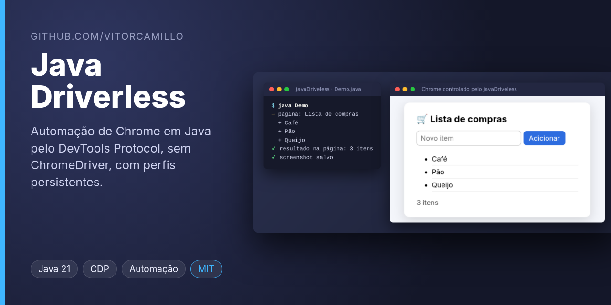
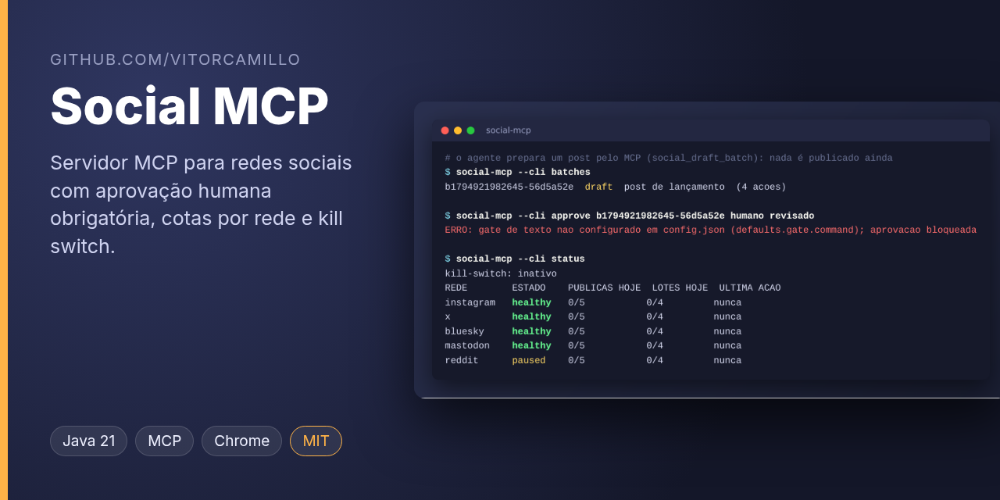
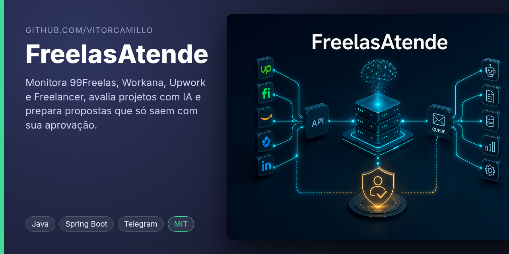
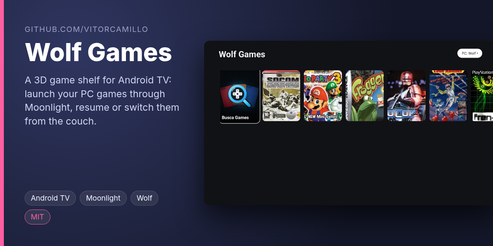

# Vitor Almeida Camillo

Desenvolvedor Full-Stack com foco em Java e Spring Boot no back-end e React/Next.js no front-end. Trabalho como autônomo desde agosto de 2022 e busco uma oportunidade 100% remota no Brasil, CLT ou PJ, como Desenvolvedor Java, Back-end, Full-Stack ou Engenheiro de Software.

## Experiência

- Desenvolvedor autônomo desde agosto de 2022, com projetos para clientes.
- 99Freelas Top Freelancer Plus, nota 5.0 em 32 projetos — [perfil](https://www.99freelas.com.br/user/vitor-camillo).
- Workana Gold.

## Stack

- **Back-end:** Java 21, Spring Boot, JPA/Hibernate, Spring Security, APIs REST e webhooks.
- **Banco de dados:** PostgreSQL e MySQL.
- **Front-end:** React, Next.js e TypeScript.
- **Outras tecnologias:** Python, Docker, Linux, pagamentos Pix, IA aplicada, agentes, MCP e revisão de código com IA.

## Produtos

- **ReservaJá** — reservas de ingressos para jogos e eventos: [reservaja.uk](https://reservaja.uk).

## Projetos open source

<table>
<tr>
<td width="50%" valign="top"> <b><a href="https://github.com/vitorcamillo/git-revisor">git-revisor</a></b> Revisão de código por IA nos hooks do Git, que bloqueia o push quebrado.</td>
<td width="50%" valign="top"> <b><a href="https://github.com/vitorcamillo/worker-ask-router">worker-ask-router</a></b> Um comando para vários agentes de IA, com troca automática no limite de uso.</td>
</tr>
<tr>
<td width="50%" valign="top"> <b><a href="https://github.com/vitorcamillo/javaDriveless">javaDriveless</a></b> Automação de Chrome em Java pelo DevTools Protocol, sem ChromeDriver.</td>
<td width="50%" valign="top"> <b><a href="https://github.com/vitorcamillo/social-mcp">social-mcp</a></b> Servidor MCP para redes sociais com aprovação humana obrigatória.</td>
</tr>
<tr>
<td width="50%" valign="top"> <b><a href="https://github.com/vitorcamillo/freelasAtende">freelasAtende</a></b> Monitora marketplaces de freelance e prepara propostas com IA.</td>
<td width="50%" valign="top"> <b><a href="https://github.com/vitorcamillo/wolf-games">wolf-games</a></b> Estante 3D de jogos para Android TV via Moonlight e Wolf.</td>
</tr>
</table>

## Formação complementar

- Mais de 700 horas de cursos na Alura — [certificado completo](https://cursos.alura.com.br/user/vitaocamillo/fullCertificate/7090d2bbe0c77b0b18e62de4c8e1c1ab).

## Links

- [Portfólio](https://portifolio.sihu.uk)
- [LinkedIn](https://www.linkedin.com/in/vitor-almeida-camillo-0abb54147/)
- [GitHub](https://github.com/vitorcamillo)

## Disponibilidade

Busco trabalho 100% remoto no Brasil, CLT ou PJ. Inglês básico.
